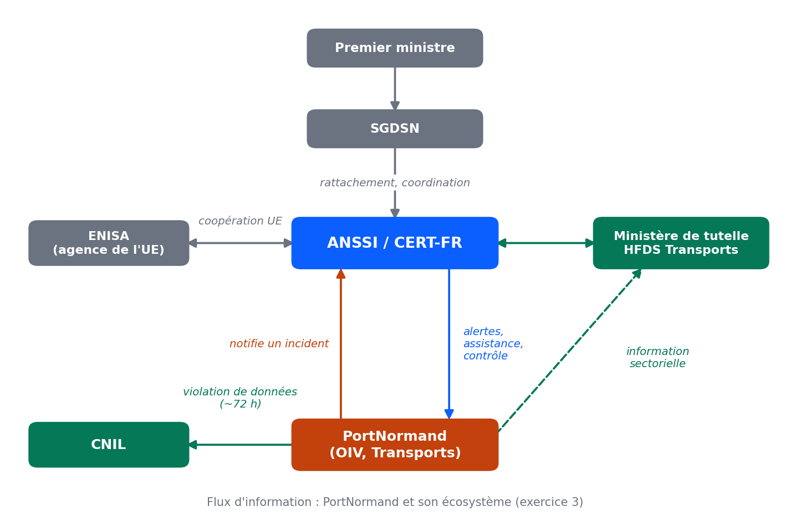

Exercice 3 : fiche des acteurs et schéma des flux

Fiche des acteurs

| Acteur | Mission | Exemple chez PortNormand |
|---|---|---|
| ANSSI | Autorité nationale de cybersécurité : prévenir, détecter et réagir, réglementer, qualifier, conseiller, sensibiliser | Reçoit les notifications d'incident de PortNormand et contrôle sa conformité |
| CERT-FR | Veille, alerte et réponse aux incidents (équipe de l'ANSSI) | PortNormand le notifie en cas de ransomware ; il alerte PortNormand en cas de faille |
| CNIL | Protection des données personnelles : conseil, contrôle, notifications de violation, sanctions | Notifiée de la violation des données de salariés et de clients, en général sous 72 h |
| SGDSN | Assiste le Premier ministre sur la défense et la sécurité nationale, coordonne les ministères, supervise l'ANSSI et le dispositif OIV | Cadre dans lequel PortNormand est OIV depuis 2015 ; échanges courants via l'ANSSI |
| Ministère de tutelle / HFDS Transports | Interlocuteur sectoriel des OIV du secteur, en lien avec l'ANSSI | Informé, en plus de l'ANSSI, après un incident majeur |
| ENISA | Appui, conseil et coordination au niveau de l'UE ; ne contrôle pas les entités | PortNormand consulte ses ressources NIS2 |

Schéma des flux d'information

